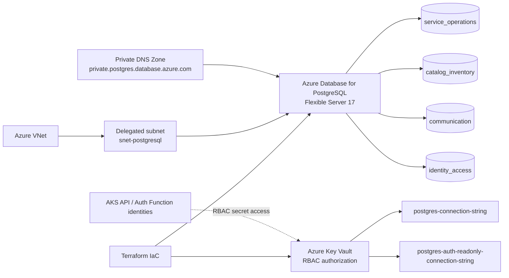

# CatCar - Database & Secrets Infrastructure (`catcar-database-infra`)

Terraform Infrastructure as Code (IaC) repository provisioning managed PostgreSQL Flexible Server, Azure Key Vault, Private DNS zones, and connection string secrets for the CatCar platform.

---

## Provisioned Infrastructure

- **Relational Database**: Azure Database for PostgreSQL Flexible Server with automated backups, custom storage configuration, and strict SSL enforcement.
- **Database Networking**: Delegated Subnet (`snet-postgresql`), Private DNS Zone (`private.postgres.database.azure.com`), and VNet Link to ensure isolated private communication.
- **Key Vault & Secrets**: Azure Key Vault with Azure RBAC authorization and a public endpoint for authenticated access, with automated secret storage for:
  - `postgres-connection-string`: Primary connection string for CatCar API.
  - `postgres-auth-readonly-connection-string`: Read-only connection string for CatCar Auth Function.
  - `customer-jwt-signing-key`: Customer JWT signing key shared with APIM.
- **Foundation dependency**: Resource group and VNet are read from the foundation Terraform state.


## Dedicated Database Infrastructure Architecture



PostgreSQL permanece privado, com SKU B1ms, 32 GiB, backup local por sete dias e sem alta disponibilidade, para reduzir custos. O Key Vault usa endpoint público para permitir que runners hospedados pelo GitHub gravem segredos; o acesso aos segredos continua protegido por Azure RBAC. A remoção do endpoint privado e do DNS privado reduz custos, mas elimina o isolamento de rede do Key Vault. A proteção contra limpeza e a exclusão reversível permanecem habilitadas.

## API Health Checks & Postman

This infrastructure stack does not expose a business API; it provides the managed dependency verified by the platform readiness probe.

- **Readiness health check:** [http://localhost:5000/health/ready](http://localhost:5000/health/ready)
- **Liveness health check:** [http://localhost:5000/health/live](http://localhost:5000/health/live)
- **Swagger UI:** [http://localhost:5000/swagger](http://localhost:5000/swagger)
- **Versioned Postman collection:** [`CatCar_Platform.postman_collection.json`](https://github.com/RiseOn-CatCar/catcar-platform/blob/main/docs/postman/CatCar_Platform.postman_collection.json)
- **Postman environment template:** [`CatCar_Platform.postman_environment.json`](https://github.com/RiseOn-CatCar/catcar-platform/blob/main/docs/postman/CatCar_Platform.postman_environment.json)

Import the environment, set `baseUrl` to the deployed API endpoint, and run **Health & Observability → Readiness health check** to validate application-to-PostgreSQL connectivity without revealing a connection string.

---

## Repository Structure

```
.
├── main.tf                    # PostgreSQL Flexible Server, Key Vault, and DNS resources
├── variables.tf               # Input parameters and defaults
├── outputs.tf                 # Server FQDN, database ID, and Key Vault URI
└── .github/workflows/ci-cd.yml # Automated lint, validation, and Azure release
```

---

## Local Validation

```bash
terraform init -backend=false
terraform fmt -check -recursive
terraform validate
```

---
For the single Azure release, provide `foundation_state_resource_group_name`, `foundation_state_storage_account_name`, `foundation_state_container_name` and `foundation_state_key`, plus the administrator, read-only and customer JWT secrets. The foundation state must already exist. Follow the [central Azure bootstrap runbook](https://github.com/RiseOn-CatCar/catcar-platform/blob/main/docs/azure-bootstrap.md); never publish Terraform state or saved plans.

The default PostgreSQL server and Key Vault names are `psql-catcar-<suffix>` and `kv-catcar-<suffix>`, where the suffix is the first eight hex characters of SHA-256 over `<subscription-id>:catcar` (for example, `3c4128ef`). Set `postgresql_server_name` and `key_vault_name` to retain existing names when adopting resources; import them into their existing Terraform resource addresses and review the plan before applying. Naming changes for other existing resources can also cause replacements, so reconcile state and resource names before migration.

## CI/CD Pipeline

- **Pull requests** validate the Terraform configuration.
- The single Azure release uses the shared foundation state and one database state; coordinate deployment through the platform release workflow.
