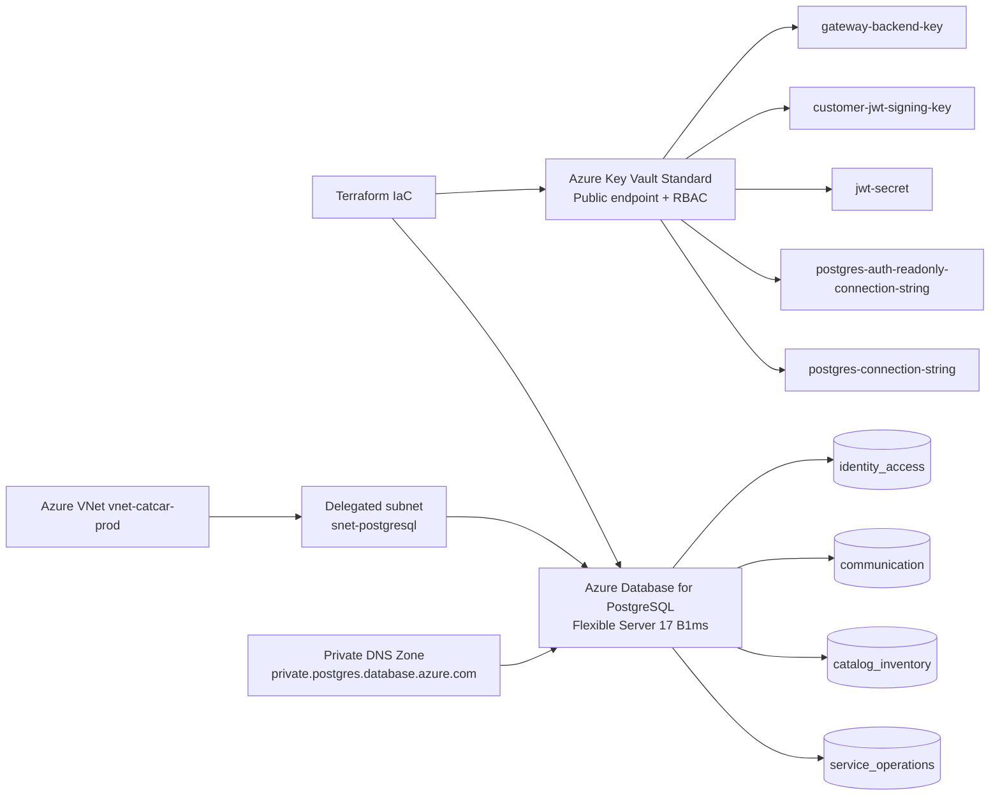

# CatCar - Database & Secrets Infrastructure (`catcar-database-infra`)

Terraform Infrastructure as Code (IaC) repository provisioning managed PostgreSQL Flexible Server, Azure Key Vault, Private DNS zones, and connection string secrets for the CatCar platform under the **academic cloud consolidation model**.

---

## Provisioned Infrastructure

- **Relational Database**: Azure Database for PostgreSQL Flexible Server 17 (`B_Standard_B1ms`, 32 GiB storage) with automated backups and strict SSL enforcement.
- **Database Networking**: Delegated Subnet (`snet-postgresql`, `10.20.2.0/24`), Private DNS Zone (`private.postgres.database.azure.com`), and VNet Link to ensure isolated private communication (`public_network_access_enabled = false`).
- **Key Vault & Secrets**: Azure Key Vault Standard (`kv-catcar-prod-<suffix>`) with Azure RBAC authorization, public endpoint enabled for OIDC runners, and automated secret storage for:
  - `postgres-connection-string`: Primary connection string for CatCar API.
  - `postgres-auth-readonly-connection-string`: Read-only connection string for CatCar Auth Function.
  - `jwt-secret`: Administrative staff JWT secret.
  - `customer-jwt-signing-key`: Customer JWT signing key.
  - `gateway-backend-key`: Ingress gateway key required by origin workloads.

---

## Dedicated Database Infrastructure Architecture



PostgreSQL traffic remains private through its delegated subnet and private DNS. Key Vault authorizes managed identities and GitHub OIDC runners with Azure RBAC (`Key Vault Secrets Officer/User`).

---

## Repository Structure

```
.
├── main.tf                    # PostgreSQL Flexible Server, Key Vault, and secret resources
├── variables.tf               # Input parameters and defaults
├── outputs.tf                 # Server FQDN, database ID, and Key Vault URI
└── .github/workflows/ci-cd.yml # Automated lint, validation, and production tag apply
```

---

## Local Validation

```bash
terraform init -backend=false
terraform fmt -check -recursive
terraform validate
```

---

## CI/CD Pipeline

- **Pull Requests / Pushes to `main`**: Runs `terraform fmt` and `terraform validate`.
- **Production Tag Push (`v*.*.*`)**: Applies changes to **Production** environment (`catcar-prod`) with state key `catcar-database.tfstate`.
